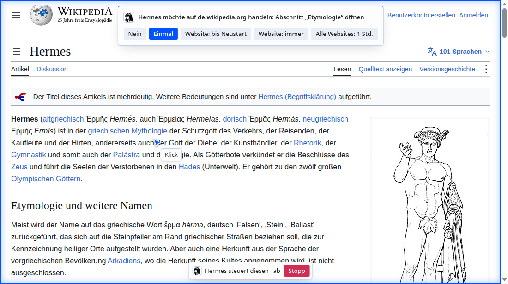
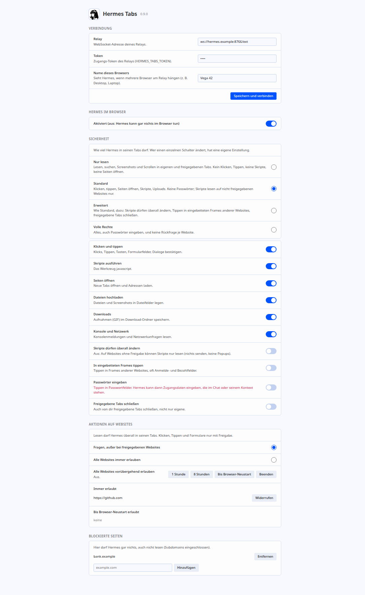
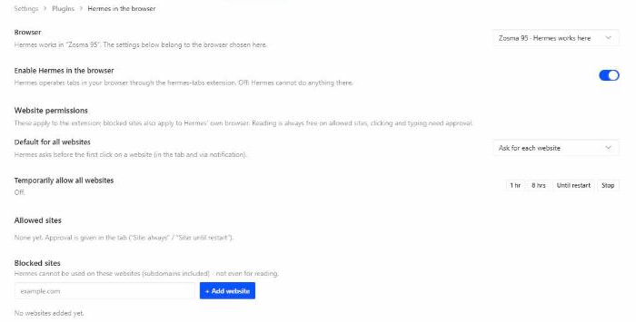

# hermes-tabs

[English](README.md) · Deutsch

Ein KI-Agent bedient einzelne Tabs in **deinem echten, angemeldeten Browser**, sichtbar und mit Freigabe pro Website.

hermes-tabs besteht aus einer Chromium-Erweiterung (Manifest V3, auf Basis von `chrome.debugger`), einem kleinen Relay-Server, der MCP spricht, und einem optionalen Plugin für den Hermes-Agenten. Jeder MCP-Client kann das Relay nutzen. Der Agent klickt, tippt, scrollt, liest Seiten und macht Screenshots in Tabs, die du ihm freigibst oder die er selbst öffnet, mit deinen bestehenden Logins, während du zusiehst.

Gedacht ist es für alle, die einen Agenten Websites nutzen lassen wollen, die keine API haben oder hinter einem Login liegen, ohne ihm ein getrenntes Browserprofil oder Zugangsdaten zu geben (Tippen in Passwortfelder ist standardmäßig gesperrt), und die sehen und stoppen wollen, was er tut.

**Vertrauter Werkzeugsatz.** Die Werkzeuge sind den Browser-Werkzeugen von Anthropics Erweiterung *Claude in Chrome* nachgebildet: weitgehend dieselben Namen (ohne die Endung `_mcp`), dieselben Parameter und derselbe Ablauf mit `ref_N`, sodass Prompts und Gewohnheiten übertragbar sind. hermes-tabs ist eine eigenständige Umsetzung auf Grundlage der veröffentlichten Werkzeugbeschreibungen und von Blackbox-Tests. Es enthält keinen Code aus Claude in Chrome und steht in keiner Verbindung zu Anthropic, das es auch nicht unterstützt oder empfiehlt.

Stand: früh. Interaktiv an ~36 gängigen Websites getestet, dazu ein automatischer Ende-zu-Ende-Test (siehe [Tests](#tests)).



<details><summary>Optionsseite der Extension und Einstellungsseite in Hermes</summary>





</details>

<sub>Die Screenshots zeigen den Wikipedia-Artikel [„Hermes“](https://de.wikipedia.org/wiki/Hermes) ([en](https://en.wikipedia.org/wiki/Hermes)) von Wikipedia-Autorinnen und -Autoren, [CC BY-SA 4.0](https://creativecommons.org/licenses/by-sa/4.0/deed.de), ergänzt um die Einblendung von hermes-tabs (Bild im Artikel: gemeinfrei). Diese Screenshots stehen deshalb unter CC BY-SA 4.0, nicht unter MIT. Die Freigabefrage ist mit `docs/screenshots.py` nachgestellt.</sub>

## Architektur

```
 Browser-Rechner                          Relay-Rechner (kann derselbe sein)      Agent
 ┌─────────────────────┐                  ┌───────────────────────────┐          ┌─────────┐
 │ Chromium + Extension│ ──WebSocket────▶ │ relay.py :8766            │ ◀──MCP── │ MCP-    │
 │  (chrome.debugger)  │   (nach außen)   │   /ext    Extension       │  (HTTP,  │ Client  │
 └─────────────────────┘                  │   /mcp    MCP-Server      │  Bearer) └─────────┘
                                          │   /admin  Einstellungen   │
                                          └───────────────────────────┘
```

- Die Extension baut die Verbindung **nach außen** zum Relay auf. Auf dem Browser-Rechner läuft kein Server, und es ist kein Port offen.
- Das Relay stellt dem Agenten die Werkzeuge per MCP (Streamable HTTP, zustandslos, JSON-Antworten) unter `/mcp` bereit.
- Mehrere Browser können am selben Relay hängen (z. B. Desktop und Laptop). Alle Aufrufe gehen an den ausgewählten Browser; ein später verbundener übernimmt nie. Ist nur einer verbunden, wird er automatisch gewählt; bei mehreren fragt dich der Agent (`list_connected_browsers`, `select_browser`) oder du klickst im gewünschten Browser auf „Verbinden“ (`switch_browser`), wie bei Claude in Chrome.
- Ist der Browser zu, scheitern Aufrufe mit „Kein Browser verbunden“ (bei mehreren Browsern mit dem Namen des fehlenden ausgewählten).
- Freigaben werden in der Extension durchgesetzt, nicht im Relay und nicht vom Agenten.

Nachrichtenformate und Interna stehen in [PROTOCOL.md](PROTOCOL.md) (englisch).

## Schnellstart

Voraussetzungen: Python 3.11 oder neuer mit [uv](https://docs.astral.sh/uv/) und ein Chromium-basierter Browser (Chrome, Chromium, Edge, Brave, Vivaldi, ...).

**1. Relay starten**

```bash
git clone <dieses Repository> && cd hermes-tabs
uv sync
export HERMES_TABS_TOKEN="$(python3 -c 'import secrets; print(secrets.token_urlsafe(32))')"
echo "$HERMES_TABS_TOKEN"     # wird in Schritt 2 und 3 gebraucht
uv run python relay.py
```

Das Relay lauscht auf `127.0.0.1:8766`. `deploy/hermes-tabs-relay.service` ist eine Beispiel-Unit für systemd (Benutzerdienst). Pfade anpassen und die Umgebungsvariablen in die Datei legen, die `EnvironmentFile` nennt.

**2. Extension laden**

1. Die Erweiterungsseite des Browsers öffnen (z. B. `chrome://extensions`) und den Entwicklermodus einschalten.
2. „Entpackte Erweiterung laden“ wählen und den Ordner `extension/` angeben.
3. Die Optionen der Extension öffnen, die Relay-Adresse (Vorgabe `ws://127.0.0.1:8766/ext`) und den Token eintragen und speichern. Hängen mehrere Browser am selben Relay, jedem einen Namen geben (z. B. Desktop, Laptop).

Das Symbol in der Werkzeugleiste zeigt ein Badge, solange keine Verbindung besteht. Steht die Verbindung, meldet `GET /admin/status` am Relay (mit `Authorization: Bearer <Token>`) die verbundenen Browser und die Version des ausgewählten.

Die Extension wird nur als entpackte Erweiterung verteilt. Ein Eintrag im Chrome Web Store ist nicht vorgesehen, weil die Berechtigung `debugger` dort nicht akzeptiert wird.

**3. MCP-Client anbinden**

Jeder MCP-Client mit Streamable-HTTP-Unterstützung kann das Relay nutzen:

| Einstellung | Wert |
|---|---|
| URL | `http://127.0.0.1:8766/mcp` |
| Transport | Streamable HTTP |
| Header | `Authorization: Bearer <HERMES_TABS_TOKEN>` |

Der Server ist zustandslos, ein Neustart des Relays bricht Client-Sitzungen also nicht ab. Anfragen mit `Origin`-Header (alles, was aus einem Browser kommt) werden mit 403 abgelehnt, als Schutz gegen DNS-Rebinding.

**Beispiel: Hermes-Agent**

Den Token als `HERMES_TABS_TOKEN` in `~/.hermes/.env` eintragen und in `config.yaml` ergänzen:

```yaml
mcp_servers:
  tabs:
    url: http://127.0.0.1:8766/mcp
    headers:
      Authorization: Bearer ${HERMES_TABS_TOKEN}
    transport: http
```

Zum optionalen Hermes-Plugin (Einstellungsseite, zusätzliche Leitplanken) siehe [Hermes-Plugin](#hermes-plugin).

**Betrieb über das Netz.** Standardmäßig lauscht das Relay nur auf localhost. Läuft Agent oder Browser auf einem anderen Rechner, `HERMES_TABS_HOST` setzen (z. B. `0.0.0.0`). Dann einen Reverse-Proxy mit TLS davorschalten und `wss://` für die Extension und `https://` für den MCP-Client verwenden. Ohne TLS laufen Token und alles, was der Agent liest, unverschlüsselt durchs Netz. Zwei Hinweise zum Proxy: Die Extension schickt den Token als Query-Parameter (`/ext?token=…`), also das Access-Log für `/ext` abschalten oder Query-Strings maskieren; und `/mcp` akzeptiert jeden `Host`-Header, dafür ist keine zusätzliche Proxy-Konfiguration nötig.

## Konfiguration

**Relay** (Umgebungsvariablen)

| Variable | Bedeutung |
|---|---|
| `HERMES_TABS_TOKEN` | Pflicht. Bearer-Token für `/mcp` und für die WebSocket-Verbindung der Extension. |
| `HERMES_TABS_ADMIN_TOKEN` | Optional. Eigener Token, nur für `/admin/settings`, `/admin/select` und `/admin/reload` (die Extension lädt nach einem Update ihre Dateien neu: `curl -X POST -H "Authorization: Bearer $HERMES_TABS_ADMIN_TOKEN" http://127.0.0.1:8766/admin/reload`). Ohne ihn lassen sich Einstellungen nicht über das Relay ändern. Dem Agenten möglichst nicht geben. Das Hermes-Plugin braucht ihn in der Umgebung des Agenten, daher muss Lockern darüber im Browser bestätigt werden (siehe [Schutzregeln](#schutzregeln)). |
| `HERMES_TABS_HOST` | Lauschadresse. Vorgabe `127.0.0.1`. |
| `HERMES_TABS_PORT` | Port. Vorgabe `8766`. |
| `HERMES_TABS_GIF_DIR` | Ordner für exportierte GIFs, Vorgabe `~/.cache/hermes-tabs`. Er muss dem Relay-Benutzer gehören und darf für andere nicht beschreibbar sein. |
| `HERMES_TABS_UPLOAD_ROOTS` | Durch Doppelpunkt getrennte Ordner, aus denen `file_upload(paths=...)` lesen darf, Vorgabe: nur `HERMES_TABS_GIF_DIR`. |

**Extension** (Optionsseite): Relay-Adresse (Vorgabe `ws://127.0.0.1:8766/ext`), Token und der Name dieses Browsers (beim ersten Start ein zufälliger Sternname wie „Vega 42“, änderbar). Die Oberfläche folgt der Browsersprache: Englisch, Deutsch, Französisch, Spanisch, Russisch, Japanisch, Chinesisch (vereinfacht und traditionell) und Arabisch.

**Hermes-Plugin** (Umgebungsvariablen des Hermes-Prozesses): `HERMES_TABS_RELAY` (Vorgabe `http://127.0.0.1:8766`), `HERMES_TABS_ADMIN_TOKEN`, `HERMES_TABS_OWN_HOSTS` (siehe unten).

## Werkzeuge

| Werkzeug | Zweck |
|---|---|
| `tabs_context`, `tabs_create`, `tabs_close` | Freigegebene Tabs auflisten, eigene öffnen und schließen |
| `list_connected_browsers`, `select_browser`, `switch_browser` | Wählen, an welchen verbundenen Browser die Aufrufe gehen |
| `navigate` | URL aufrufen, `back` / `forward` |
| `read_page` | Baum mit `ref_N`-Handles; `filter="interactive"`, `ref_id`, `depth`, `max_chars` |
| `find` | Elemente nach Zweck oder Text finden (Wortabgleich; versteht englische und deutsche Wörter wie „search field“ / „Suchfeld“) |
| `form_input` | Feld, Checkbox oder Auswahlliste per Ref setzen (Passwortfelder nur, wenn erlaubt) |
| `computer` | `left_click`, `right_click`, `double_click`, `triple_click`, `hover`, `left_click_drag`, `type`, `key` (mit `repeat`), `scroll`, `scroll_to`, `screenshot`, `zoom`, `wait` |
| `get_page_text` | Seitentext, Hauptinhalt bevorzugt |
| `javascript` | JavaScript in der Seite (REPL-Stil, `await` geht) |
| `read_console_messages`, `read_network_requests` | Konsole und Netzwerk (Zugangswerte in URLs werden geschwärzt) |
| `file_upload`, `upload_image` | Dateien bzw. frühere Screenshots in Datei-Felder oder Drop-Ziele legen |
| `resize_window` | Fenstergröße ändern (begrenzt auf den Bildschirm) |
| `gif_creator` | Sitzung als GIF aufnehmen |
| `browser_batch` | Mehrere Aufrufe in einem Schritt |
| `handle_dialog` | `alert`-, `confirm`- und `prompt`-Dialoge beantworten |

Gut zu wissen:

- Mausaktionen und die meisten Lesezugriffe funktionieren auch in Hintergrund-Tabs. Screenshots brauchen einen gezeichneten Tab, siehe [Bekannte Grenzen](#bekannte-grenzen).
- `read_page` durchläuft auch offene Shadow-DOMs und iframes derselben Herkunft.
- Screenshots kommen in CSS-Pixeln. Klick-Koordinaten stimmen damit auch bei Bildschirmskalierung und Browserzoom.
- Dialoge blockieren nicht: Der Befehl meldet den Dialog, `handle_dialog` beantwortet ihn.
- Der Agent bedient nur `http(s)`-Seiten (dazu `data:` und `about:blank`), nie lokale Dateien oder Browser- und Extension-Seiten. Auf `data:` und `about:blank` liest er nur und handelt nicht; Skripte können dort nur lesen.
- Welche Werkzeuge funktionieren, hängt von der [Sicherheitsstufe](#schutzregeln) ab; ein ausgeschaltetes Werkzeug antwortet mit einer klaren Meldung.

## Sichtbarkeit und Stopp

Solange der Agent in einem Tab arbeitet:

- Ein farbiger Rahmen zeigt, dass der Tab gesteuert wird.
- Ein Zeiger gleitet zur Klickstelle, ein Ring markiert den Klick, und ein Etikett nennt die Aktion (`action_summary` des Werkzeugs).
- Unten steht eine Leiste „Hermes steuert diesen Tab“ mit einem **Stopp**-Knopf.
- Nach 6 s Ruhe verschwindet alles. Screenshots, die der Agent erhält, enthalten das Overlay nicht.

**Stopp** entzieht dem Tab die Freigabe, nimmt ihn aus der Tab-Gruppe „Hermes“ und trennt den Debugger. Während der Agent klickt, lässt das Overlay Klicks durch, damit er weder Stopp noch eine Freigabe-Taste treffen kann. Die Knöpfe reagieren nur auf echte Nutzerklicks: Die Seite kann sie nicht auslösen und keine Freigabe fälschen.

Die Seite kann das Overlay erkennen, solange es angezeigt wird, und versuchen, es zu entfernen oder zu verstecken. Die Extension stellt es wieder her; macht die Seite damit weiter, hört die Extension mit dem Gegenhalten auf, markiert das Symbol des Tabs mit „!“, zeigt eine Desktop-Benachrichtigung und warnt den Agenten in jeder Antwort, bis die Seite verlassen wird. Für Freigaben ist die Desktop-Benachrichtigung der zweite Kanal, an den die Seite nicht herankommt.

Der Browser selbst zeigt auf gesteuerten Tabs außerdem seinen Hinweis „wird debuggt“. Das lässt sich nicht abschalten.

## Welche Tabs der Agent bedienen darf

- Tabs, die der Agent selbst öffnet. Sie kommen in die Tab-Gruppe „Hermes“, und nur diese darf der Agent schließen.
- Tabs, die du per Klick aufs Symbol der Extension freigibst (Badge mit Haken; ein zweiter Klick entzieht die Freigabe).
- Tabs, die ein Agent-Tab öffnet (z. B. Links mit `target=_blank`), gehören ebenfalls dem Agenten.

Nach einem Neuladen der Extension oder einem Browser-Neustart werden Tabs in einer Tab-Gruppe namens „Hermes“ wieder als eigene Tabs des Agenten übernommen (eine eigene Gruppe mit diesem Namen zählt also als Agenten-Tabs).

Freigaben gelten bis zum Neustart des Browsers. Die Grenze liegt beim Tab, nicht beim Konto: In einem freigegebenen Tab hat der Agent deine Logins auf dieser Seite.

## Freigaben pro Website

Lesen ist in freigegebenen Tabs frei. **Handeln** braucht deine Zustimmung für die Website: Klicken, Tippen, Tasten, `form_input`, Uploads und das Bestätigen von Dialogen. Die Frage erscheint im Tab und als Desktop-Benachrichtigung. Wegklicken heißt Nein; nach 50 s ohne Antwort lehnt die Extension ab. Tabs, die du selbst freigegeben hast, gelten als zugestimmt für die Website, die sie beim Freigeben zeigten (auch für andere Seiten dieser Website). Bringt der Agent einen solchen Tab auf eine andere Website, fragt er dort wie üblich; der Tab bleibt freigegeben, Lesen geht weiter. Die Frage zeigt die eigene Beschreibung des Agenten in einer eigenen Zeile („Hermes sagt: …“, höchstens 120 Zeichen). Die Stufe `full` überspringt die Frage; in den Stufen ohne die Fähigkeit `act` handelt der Agent gar nicht (siehe [Schutzregeln](#schutzregeln)).

Freigabe-Stufen:

| Stufe | Reichweite |
|---|---|
| Einmal | dieser Tab und diese Website, einmalig |
| Diese Website bis Browser-Neustart | |
| Diese Website immer | |
| Alle Websites für 1 Stunde oder 8 Stunden | |
| Alle Websites bis Browser-Neustart | |
| Alle Websites immer | |

Im Tab stehen fünf Knöpfe zur Wahl, in der Desktop-Benachrichtigung zwei („Diese Website bis Neustart“ und „Alle Websites 1 Stunde“). In den Optionen der Extension lassen sich Zeitfenster starten und beenden und Websites widerrufen.

**Gesamtschalter und blockierte Seiten.** Die Optionsseite hat einen Gesamtschalter: Ist er aus, kann der Agent im Browser gar nichts tun. Ihn wieder einzuschalten und eine blockierte Seite zu entfernen muss im Browser bestätigt werden (siehe [Schutzregeln](#lockern-braucht-deine-bestätigung)). Blockierte Seiten sind Domains (Subdomains eingeschlossen), auf denen der Agent nicht einmal lesen darf. Geprüft wird gegen die echte Tab-URL, auch nach Weiterleitungen, und vor dem Öffnen oder Navigieren.

**Einstellungen übers Relay.** `GET/POST /admin/settings` mit `HERMES_TABS_ADMIN_TOKEN`:

```bash
curl -H "Authorization: Bearer $HERMES_TABS_ADMIN_TOKEN" -H "Content-Type: application/json" \
     -d '{"allowAll": "8h"}' http://127.0.0.1:8766/admin/settings
# {"allowAll": "off"}   {"sites": {"https://example.com": "always"}}   {"siteMode": "ask"}
# {"enabled": false}    {"blockedSites": ["bank.example"]}
# {"safety": {"tier": "read"}}    {"safety": {"passwords": false}}
```

`GET` liefert auch `safety`: die Stufe `tier` (`read`, `standard`, `extended`, `full` oder `custom`) und die zehn Schalter aus den [Schutzregeln](#einzelschalter). Eine Extension ohne `safety` verhält sich wie `standard`. `POST` mit `{"safety": {...}}` setzt eine Stufe oder einzelne Schalter. Verschärfen gilt sofort; jedes Lockern (auch `siteMode: "all"`, `allowAll`, `sites` auf `always`/`session`, `enabled: true`, Entfernen blockierter Seiten) wartet im Browser auf die Bestätigung des Menschen, bis zu 120 s. Die Antwort (Status 200, nach bis zu etwa 2 Minuten) enthält die jetzt geltenden Einstellungen sowie `confirmation` (`not_needed`, `confirmed`, `declined` oder `expired`) und `loosening`, die Liste der erfragten Lockerungen. Es wartet immer nur eine Bestätigung; eine zweite Lockerung bekommt solange 409.

Hängen mehrere Browser am Relay, spricht `?device=<deviceId>` einen davon an (ohne: den Browser, den der Agent verwendet). Die Antwort nennt den Browser (`browser`) und listet alle verbundenen (`browsers`). `POST /admin/select` mit `{"deviceId": "..."}` wählt den Browser für den Agenten.

## Schutzregeln

Wie weit der Agent gehen darf, legt eine **Sicherheitsstufe** fest. Jede Stufe ist eine Voreinstellung einzelner Schalter; Stufe oder Einzelschalter stellst du in den Optionen der Extension ein, mit dem Hermes-Plugin auch in den Hermes-Einstellungen.

### Sicherheitsstufen

| Stufe | Was der Agent darf |
|---|---|
| `read` | Nur lesen: Seiteninhalt, Screenshots, Konsole und Netzwerkprotokoll. Kein Klicken oder Tippen, keine Skripte, kein Öffnen von Seiten, keine Uploads oder Downloads. |
| `standard` (Vorgabe) | Alle Fähigkeiten; jede Website braucht deine Freigabe vor der ersten Handlung. Alle Lockerungen aus. So verhält sich alles, was im übrigen README beschrieben ist. |
| `extended` | `standard` plus: Skripte dürfen auf nicht freigegebenen Seiten schreiben und Popups öffnen, Tippen in iframes fremder Websites, auch von dir freigegebene Tabs schließen. |
| `full` | Alles, auch in Passwortfelder tippen, und keine Rückfrage je Website. Nur für Aufgaben, denen du voll vertraust. |
| `custom` | Wird angezeigt, wenn Einzelschalter von jeder Stufe oben abweichen. |

### Einzelschalter

Fähigkeiten (an = erlaubt):

| Schalter | Umfasst |
|---|---|
| `act` | Klicken, Tippen, Tasten, `form_input`, Dialoge bestätigen |
| `js` | Das Werkzeug `javascript` |
| `navigate` | Tabs öffnen und Seiten laden |
| `upload` | `file_upload`, `upload_image` |
| `download` | Ein GIF im Download-Ordner des Browsers speichern (`gif_creator` mit `download=true`). Aufnahme und Export auf dem Relay-Rechner betrifft der Schalter nicht. |
| `devtools` | `read_console_messages`, `read_network_requests` |

Lockerungen (an = der Schutz ist aufgehoben; Vorgabe überall aus):

| Schalter | Hebt auf |
|---|---|
| `scriptWrites` | Den Schreibschutz von `javascript` auf nicht freigegebenen Seiten: Nicht-GET-Anfragen und Popups sind dann erlaubt |
| `frameTyping` | Das Verbot, in iframes fremder Websites zu tippen (Anmelde- und Zahlungs-Widgets) |
| `passwords` | Das Verbot, in Passwortfelder zu tippen, siehe [Passwörter](#passwörter) |
| `closeShared` | Die Grenze, dass `tabs_close` nur eigene Tabs des Agenten schließt: dann auch von dir freigegebene Tabs |

### Immer fest

Das gilt in jeder Stufe:

- **Nur freigegebene oder selbst geöffnete Tabs.** Jedes Werkzeug, das einen Tab anfasst, prüft das zuerst.
- **Geschützte Seiten.** `file:`, `chrome:`, `chrome-extension:` und ähnliche URLs werden abgelehnt. Sonst könnte der Agent die Extension-APIs erreichen oder lokale Dateien lesen.
- **Sichtbar und stoppbar.** Rahmen, Zeiger, Beschriftung und eine Leiste mit **Stopp** zeigen, was im Tab geschieht (siehe [Sichtbarkeit und Stopp](#sichtbarkeit-und-stopp)). Die Knöpfe reagieren nur auf echte Nutzerklicks; die Seite kann sie nicht auslösen, und versteckt sie die Einblendung hartnäckig, erfahren du und der Agent davon.
- **Seitenskripte sind isoliert.** `read_page`, `find` und `form_input` laufen in einer isolierten Welt, die Seite kann sie nicht manipulieren.
- **Uploads sind eingegrenzt.** `file_upload` liest nur unterhalb der konfigurierten Upload-Ordner, nur normale Dateien, mit 10 MB Gesamtgrenze.
- **Protokoll.** Das Relay schreibt jeden Browser-Aufruf nach stdout/Journal: Werkzeug und Parameter, jede Zeichenkette auf 80 Zeichen gekürzt. Getippter Text, `form_input`-Werte und Skript-Quelltext erscheinen also gekürzt; Dateiinhalte und Bilder nie. In Passwortfelder getippter Text wird geschwärzt, ein Passwort im Quelltext eines Skripts aber nicht (siehe [Passwörter](#passwörter)).
- **Gesamtschalter und blockierte Seiten.** Bei ausgeschaltetem Gesamtschalter und auf blockierten Seiten kann der Agent nichts tun, egal in welcher Stufe.
- **Seiteninhalt ist Daten, kein Auftrag.** Die MCP-Hinweise des Relays weisen den Agenten an, Text auf Webseiten so zu behandeln. Das ist eine Anweisung ans Modell, keine technische Garantie.

### Lockern braucht deine Bestätigung

Verschärfen (strengere Stufe, Fähigkeit oder Lockerung ausschalten) gilt sofort. **Lockern** (großzügigere Stufe, Fähigkeit oder Lockerung einschalten, „alle Websites“, Zeitfenster, eine Website freigeben, den Gesamtschalter wieder einschalten, eine blockierte Seite entfernen) muss ein Mensch im Browser bestätigen: Die Extension stellt eine Frage, und die Änderung gilt erst, wenn du zustimmst. Das gilt auch, wenn die Änderung über die Admin-Schnittstelle des Relays kommt (etwa von der Hermes-Einstellungsseite); das Relay wartet bis zu 120 s auf deine Antwort und lässt sonst alles, wie es war.

Der Grund: Das Hermes-Plugin braucht den Admin-Token in der Umgebung des Agenten-Prozesses, also darf der Token allein nicht genügen, um Grenzen aufzuheben. Ein Agent, der den Token lesen kann, kann damit trotzdem nichts lockern. Änderungen, die du direkt auf der Optionsseite der Extension machst, sind deine eigene Entscheidung.

### Passwörter

Passwortfelder sind standardmäßig gesperrt: Der Agent tippt nie hinein (auch nicht in Felder mit `autocomplete=...password`, und nicht per Einfüge-Tasten wie Strg+V, Cmd+V oder Umschalt+Einfg, oder Enter). Tasten, die den Fokus in ein Passwortfeld bewegen, beenden die Tastenfolge dort. Pfeil- und Bildtasten in einem Anmeldefeld werden ebenfalls abgelehnt, weil sie einen im Browser gespeicherten Login auswählen könnten (Autofill). Mit der Stufe `full` oder dem Schalter `passwords` erlaubst du es. **Dann kann der Agent beliebige Zugangsdaten eingeben, die er kennt** (etwa aus deinen Anweisungen oder von der Seite) und sich als du anmelden. Schalte es nur für die Aufgabe ein, die es braucht, und danach wieder aus. So eingegebene Passwörter werden im Log des Relays geschwärzt. Die Hermes-Einstellungsseite zeigt eine rote Warnung, solange es an ist.

Grenzen des Schalters:

- Er gilt für `type`, `key` und `form_input`. Auf einer Website, die du freigegeben hast, kann ein `javascript`-Aufruf trotzdem ein Passwortfeld füllen und das Formular absenden. Die MCP-Anweisungen des Relays verbieten das, technisch verhindert ist es nicht, und der Skript-Quelltext (die ersten 80 Zeichen) enthielte das Passwort dann im Log des Relays.
- Die eigenen Autofill-Popups des Browsers hat die Extension nicht vollständig im Griff.

## Hermes-Plugin

`hermes-plugin/` ergänzt für den Hermes-Agenten eine Einstellungsseite und einige zusätzliche Leitplanken. Die Einstellungen gehören der Extension; das Plugin liest und schreibt sie über `/admin/settings` (und wählt den Browser über `/admin/select`), durchgesetzt wird weiterhin in der Extension.

Einstellungsseite: in welchem Browser Hermes arbeitet (bei mehreren Browsern am Relay: die Einstellungen jedes Browsers ansehen und den für Hermes wählen), Gesamtschalter, Sicherheitsstufe und Einzelschalter (Verschärfen gilt sofort, Lockern zeigt „Bitte im Browser bestätigen …“, bis du dort antwortest; eine rote Warnung erscheint, solange Hermes Passwörter eingeben darf), Standard für alle Websites (fragen oder alle erlauben), vorübergehendes „alle erlauben“, erlaubte Seiten, blockierte Seiten.

Der `pre_tool_call`-Hook des Plugins ergänzt das Folgende. Er erkennt die Browser-Werkzeuge am Präfix `mcp__tabs__`, deshalb muss der MCP-Server in der Hermes-Konfiguration `tabs` heißen (wie im Beispiel oben):

- Gesamtschalter aus: `mcp__tabs__*` wird vorab abgelehnt.
- Ist `HERMES_TABS_OWN_HOSTS` gesetzt (kommagetrennte Hosts der eigenen Oberfläche des Agenten; Vorgabe leer), bedient der Agent diese Hosts über die Extension nie, damit er sich über den Browser keine Rechte geben kann.
- Zum Einschalten, Vorgabe aus: Mit dem Schalter „Auch für Hermes’ andere Web-Werkzeuge sperren“ auf der Plugin-Seite gelten blockierte Seiten und `HERMES_TABS_OWN_HOSTS` auch für Hermes' eigene Browser-Werkzeuge (`browser_exec`, `browser_cdp`) und für `web_extract`, wenn die Domain in den Argumenten steht. Grenze: Bei freiem Code in `browser_exec` erkennt der Hook zusammengesetzte URLs und Klicks auf Links nicht.

Ist der Browser zu, gilt für den Hook der zuletzt gesehene Stand.

Installation:

1. `hermes-plugin/` nach `~/.hermes/plugins/hermes-tabs/` legen.
2. `desktop/plugin.js` zusätzlich nach `~/.hermes/desktop-plugins/hermes-tabs/` kopieren.
3. `hermes-tabs` in `plugins.enabled` der `config.yaml` eintragen.
4. `HERMES_TABS_ADMIN_TOKEN` (und bei Bedarf `HERMES_TABS_RELAY`, `HERMES_TABS_OWN_HOSTS`) in `~/.hermes/.env` setzen.
5. Gateway neu starten.

Die Einstellungsseite ist die Desktop-Hälfte des Plugins und opt-in: In der Hermes-Oberfläche unter Capabilities → Plugins den Filter „Installed“ wählen, das Plugin öffnen und „Desktop“ einschalten. Das gilt je Browser-Profil.

Selbsttest des Hooks: `python3 hermes-plugin/__init__.py`.

## Bekannte Grenzen

- **Der Schreibschutz ist eine Leitplanke, keine Sandbox.** Solange `scriptWrites` aus ist, blockiert er Nicht-GET-Anfragen, die `javascript` auf nicht freigegebenen Seiten (und immer auf `data:` und `about:blank`) auslöst, bis zum nächsten Laden der Seite. In einem Tab, den du selbst freigegeben hast, endet er 3 s nach dem Skript, damit deine eigene Arbeit im Tab nicht blockiert wird; Anfragen, die ein Skript länger hinauszögert, kommen dort durch. WebSocket-Nachrichten, Service Worker und GET-Anfragen mit Nebenwirkungen erfasst er nicht. `javascript` auf nicht freigegebenen Seiten ist damit nur per Konvention lesend, nicht per Garantie.
- **Der Agent arbeitet mit deinen Logins.** In einem freigegebenen Tab kann er auf dieser Seite alles, was du auch kannst, sobald du die Website freigibst. Gib nur frei, was du ihm zutraust.
- **Screenshots holen den Tab kurz nach vorn.** Browser zeichnen Hintergrund-Tabs nicht, deshalb wird der Tab für einen Screenshot einen Moment lang in seinem Fenster nach vorn geholt; danach ist dein vorheriger Tab wieder aktiv. Das Fenster muss sichtbar sein: Ein verdecktes oder minimiertes Fenster rendert nichts, nach 6 s kommt „Kein Bild“, die Text-Werkzeuge arbeiten weiter.
- **Keine CAPTCHAs, und standardmäßig keine Passwörter.** Der Agent löst keine CAPTCHAs und tippt nicht in Passwortfelder, solange du es nicht erlaubst (siehe [Passwörter](#passwörter)). Wo das nötig ist, musst du den Schritt selbst machen. Manche Seiten verweigern außerdem Eingaben, wenn der Tab gesteuert wird.
- Inhalte in iframes fremder Herkunft liefert `read_page` nicht; dann mit Screenshot und Koordinaten arbeiten.
- Einen Dialog, der beim Laden aufging, bevor die Extension zugreifen konnte, kann nur du im Browser bestätigen. Bei eigenen Tabs hilft `tabs_close`.
- Popups von Passwortmanagern trennen den Debugger. Beim nächsten Befehl verbindet sich die Extension neu.
- PDF-Ansicht und andere eingebaute Browser-Seiten sind nicht bedienbar; der Agent bekommt eine klare Meldung.

## Tests

```bash
uv run python smoke_test.py
```

Braucht `chromium` oder `google-chrome` im `PATH`; ein Lauf dauert etwa 3–4 Minuten.

Der Test startet das Relay, headless Chromium mit geladener Extension und eine Testseite (iframe, Shadow DOM, Dialog, HTML5-Drag&Drop, Slider, Datei-Feld, Konsole, Netzwerk, Tastenkürzel). Er ruft alle Werkzeuge über MCP auf, einmal mit Skalierung 1 und einmal mit 2, und prüft außerdem die Tab-Grenze, den Token, Freigaben (keine Antwort, Nein, Einmal, Immer, Widerruf in den Optionen), Stopp, die Passwortsperre, fremde iframes, den Skript-Schreibschutz (auch Popup und Web Worker) mehrere Browser an einem Relay (mit einem simulierten zweiten Browser), die Website-Bindung selbst freigegebener Tabs, `data:`-Seiten, Autofill- und Einfüge-Tasten, eine Seite, die das Overlay entfernt, und dass der Token des Agenten die Admin-Routen nicht nutzen kann. Die Nutzerklicks laufen dabei über einen eigenen Debugger als echte Mausereignisse.

Ports lassen sich mit `SMOKE_RELAY_PORT`, `SMOKE_PAGE_PORT` und `SMOKE_CDP_PORT` ändern, damit mehrere Läufe parallel gehen. Mit `SMOKE_SHOTS=<Ordner>` legt der Test Bilder des Overlays ab.

## Lizenz

MIT – siehe [LICENSE](LICENSE).

Das Hermes-Logo in der Extension (Symbol, Optionsseite, Einblendung) ist © Nous Research, MIT-Lizenz (siehe [extension/NOTICE](extension/NOTICE)). hermes-tabs ist kein offizielles Projekt von Nous Research.
