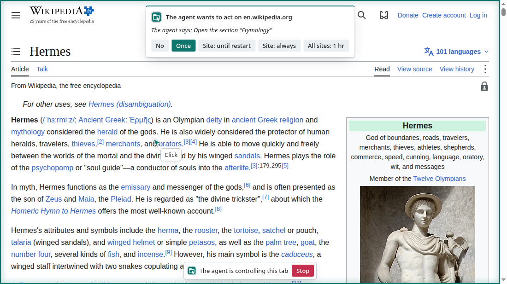
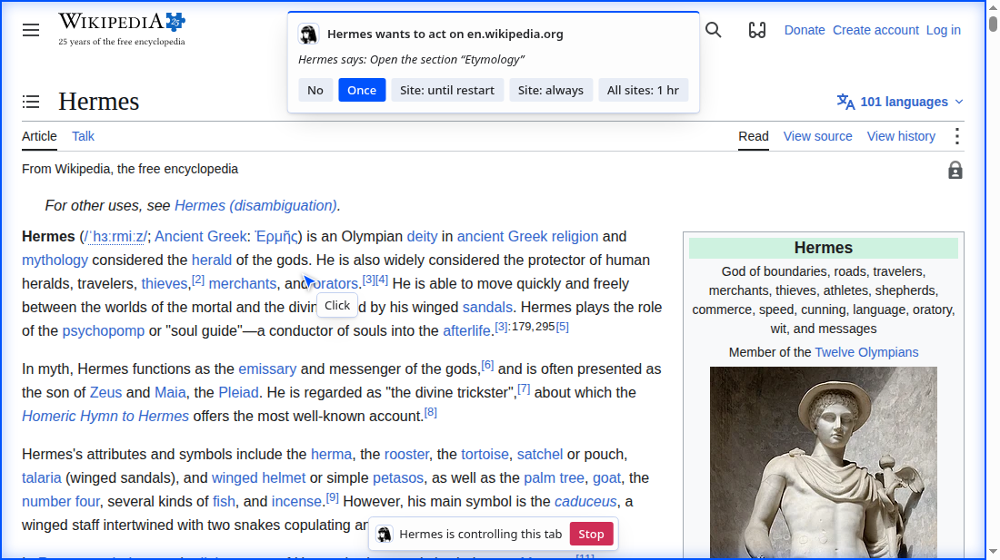
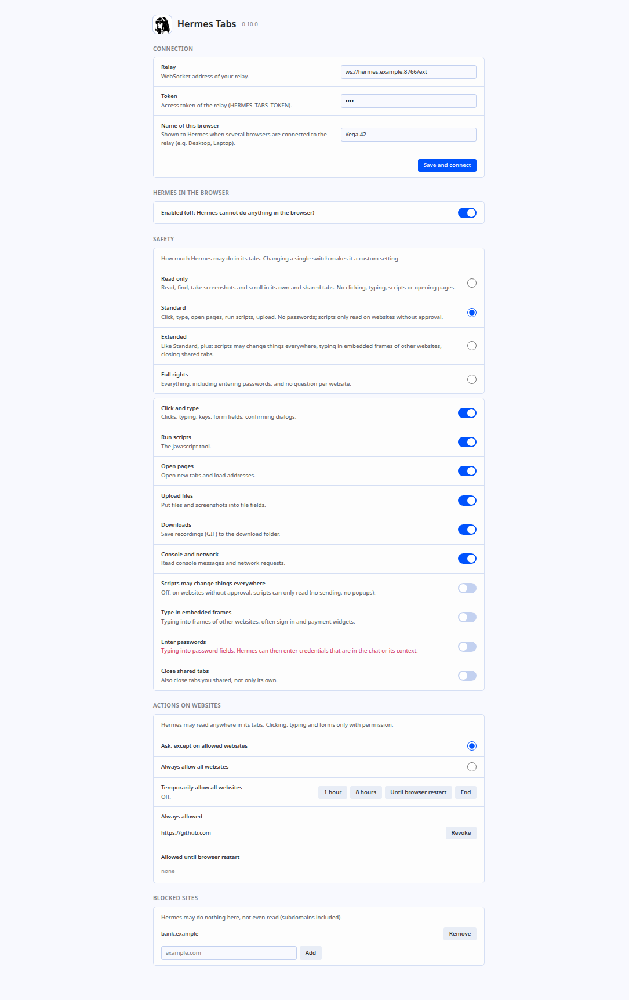

# hermes-tabs

Let an AI agent work in individual tabs of **your real, signed-in browser**, visibly and with per-site permission.

English · [Deutsch](README.de.md)

hermes-tabs is a Chromium extension (Manifest V3, built on `chrome.debugger`), a small relay server that speaks MCP, and an optional plugin for the Hermes agent. Any MCP client can use the relay. The agent clicks, types, scrolls, reads pages and takes screenshots in tabs you share with it or that it opens itself, with your existing logins, while you watch.

It is for people who want an agent to use sites that have no API or sit behind a login, without handing the agent a separate browser profile or their credentials (typing into password fields is off by default), and who want to see and stop what it does.

**Two packages from one source.** `build.py` builds the extension twice: **Hermes Tabs** (Hermes look and logo, the tab group is called "Hermes", goes with the optional [Hermes plugin](#hermes-plugin)) and **Agent Tabs** (neutral look with its own icon, the tab group is called "Agent", no mention of Hermes) for any other agent or MCP client, such as Claude Code, Codex, Cursor or OpenCode. Code, tools, safeguards and relay are the same; only the name, colours, icons and the texts that name the agent differ. Both can be installed side by side. Ready-made zips of both are attached to each [release](https://github.com/ai-ag2026/hermes-tabs/releases).



**Familiar tool set.** The tools are modelled on the browser tools of Anthropic's *Claude in Chrome* extension: largely the same names (without the `_mcp` suffix), the same parameters and the same `ref_N` workflow, so prompts and habits carry over. hermes-tabs is an independent implementation built from the published tool descriptions and black-box testing. It contains no code from Claude in Chrome and is not affiliated with or endorsed by Anthropic.

Status: early. Tested interactively on ~36 popular websites and by an automated end-to-end test (see [Tests](#tests)).



<details><summary>Options page of the extension and settings page in Hermes</summary>




</details>

<sub>The screenshots show the Wikipedia article [“Hermes”](https://en.wikipedia.org/wiki/Hermes) ([de](https://de.wikipedia.org/wiki/Hermes)) by Wikipedia contributors, [CC BY-SA 4.0](https://creativecommons.org/licenses/by-sa/4.0/), with the hermes-tabs overlay added (image in the article: public domain). These screenshots are therefore licensed CC BY-SA 4.0, not MIT. The consent prompt is staged with `docs/screenshots.py`.</sub>

## Architecture

```
 Browser machine                          Relay machine (can be the same)         Agent
 ┌─────────────────────┐                  ┌───────────────────────────┐          ┌─────────┐
 │ Chromium + extension│ ──WebSocket────▶ │ relay.py :8766            │ ◀──MCP── │ MCP     │
 │  (chrome.debugger)  │   (outbound)     │   /ext    extension       │  (HTTP,  │ client  │
 └─────────────────────┘                  │   /mcp    MCP server      │  Bearer) └─────────┘
                                          │   /admin  settings, status│
                                          └───────────────────────────┘
```

- The extension opens the connection **outward** to the relay. The browser machine runs no server and has no open port.
- The relay exposes the tools to the agent over MCP (streamable HTTP, stateless, JSON responses) at `/mcp`.
- Several browsers can be connected to one relay (for example desktop and laptop). All calls go to the selected browser; a browser that connects later never takes over. With a single browser it is selected automatically; with several, the agent asks you (`list_connected_browsers`, `select_browser`) or you click "Connect" in the browser you want (`switch_browser`), as with Claude in Chrome.
- If the browser is closed, tool calls fail with "no browser connected" (or, with several browsers, name the selected browser that is missing).
- Permissions are enforced inside the extension, not in the relay and not by the agent.

Message formats and internals are in [PROTOCOL.md](PROTOCOL.md).

## Quickstart

Requirements: Python 3.11 or newer with [uv](https://docs.astral.sh/uv/), and a Chromium-based browser (Chrome, Chromium, Edge, Brave, Vivaldi, ...).

**1. Start the relay**

```bash
git clone <this repository> && cd hermes-tabs
uv sync
export HERMES_TABS_TOKEN="$(python3 -c 'import secrets; print(secrets.token_urlsafe(32))')"
echo "$HERMES_TABS_TOKEN"     # you need it in steps 2 and 3
uv run python relay.py
```

The relay listens on `127.0.0.1:8766`. `deploy/hermes-tabs-relay.service` is a sample systemd user unit; adjust its paths and put the environment variables in the file named by `EnvironmentFile`.

**2. Load the extension**

1. Open the extensions page of your browser (for example `chrome://extensions`) and turn on developer mode.
2. Choose "Load unpacked" and select the `extension/` folder (Hermes Tabs) or, after `python build.py`, the `dist/agent-tabs/` folder (Agent Tabs). You can also unpack a zip from the releases and select that folder.
3. Open the extension's options. Enter the relay address (default `ws://127.0.0.1:8766/ext`) and the token, then save. If several browsers use the same relay, give each a name (for example Desktop, Laptop).

The toolbar icon shows a badge while the extension is disconnected. Once it is connected, `GET /admin/status` on the relay (with `Authorization: Bearer <token>`) reports the connected browsers and the version of the selected one.

The extension is distributed only as an unpacked extension. A Chrome Web Store listing is not planned, because the `debugger` permission is not accepted there.

**3. Connect an MCP client**

Any MCP client that supports streamable HTTP can use the relay:

| Setting | Value |
|---|---|
| URL | `http://127.0.0.1:8766/mcp` |
| Transport | streamable HTTP |
| Header | `Authorization: Bearer <HERMES_TABS_TOKEN>` (or `AGENT_TABS_TOKEN`, see [Configuration](#configuration)) |

The server is stateless, so restarting the relay does not break client sessions. Requests that carry an `Origin` header (anything coming from a browser) are rejected with 403, as protection against DNS rebinding.

**Example: Hermes agent**

Put the token into `~/.hermes/.env` as `HERMES_TABS_TOKEN` and add to `config.yaml`:

```yaml
mcp_servers:
  tabs:
    url: http://127.0.0.1:8766/mcp
    headers:
      Authorization: Bearer ${HERMES_TABS_TOKEN}
    transport: http
```

For the optional Hermes plugin (settings page, extra guard rails) see [Hermes plugin](#hermes-plugin).

**Example: Claude Code**

```bash
claude mcp add --transport http tabs http://127.0.0.1:8766/mcp --header "Authorization: Bearer $AGENT_TABS_TOKEN"
```

This writes the token itself into Claude Code's configuration. To try it without changing the configuration, pass a JSON file with the same server to `claude --mcp-config <file>`.

**Example: Codex**

```toml
# ~/.codex/config.toml (Codex reads the token from the environment variable when it starts)
[mcp_servers.tabs]
url = "http://127.0.0.1:8766/mcp"
bearer_token_env_var = "AGENT_TABS_TOKEN"
```

**Running over a network.** By default the relay only listens on localhost. If the agent or the browser is on another machine, set `HERMES_TABS_HOST` (for example `0.0.0.0`). Then put a reverse proxy with TLS in front of the relay and use `wss://` for the extension and `https://` for the MCP client. Without TLS, the token and everything the agent reads cross the network in clear text. Two things to know about the proxy: the extension sends the token as a query parameter (`/ext?token=…`), so turn off the access log for `/ext` or mask query strings; and `/mcp` accepts any `Host` header, so no extra proxy configuration is needed for it.

## Configuration

**Relay** (environment variables)

| Variable | Meaning |
|---|---|
| `HERMES_TABS_TOKEN` | Required. Bearer token for `/mcp` and for the extension's WebSocket. |
| `HERMES_TABS_ADMIN_TOKEN` | Optional. Separate token, valid only for `/admin/settings`, `/admin/select` and `/admin/reload` (the extension reloads its files after an update: `curl -X POST -H "Authorization: Bearer $HERMES_TABS_ADMIN_TOKEN" http://127.0.0.1:8766/admin/reload`). Without it, settings cannot be changed through the relay. Keep it away from the agent where you can. The Hermes plugin needs it in the agent's environment, so loosening through it must be confirmed in the browser (see [Safeguards](#safeguards)). |
| `HERMES_TABS_HOST` | Listen address. Default `127.0.0.1`. |
| `HERMES_TABS_PORT` | Port. Default `8766`. |
| `HERMES_TABS_GIF_DIR` | Directory for exported GIFs, default `~/.cache/hermes-tabs`. The relay user must own it and others must not be able to write to it. |
| `HERMES_TABS_UPLOAD_ROOTS` | Colon-separated directories that `file_upload(paths=...)` may read from, default: only `HERMES_TABS_GIF_DIR`. |

Every variable can also be spelled `AGENT_TABS_…` (for example `AGENT_TABS_TOKEN`); that spelling wins if both are set.

**Extension** (options page): relay address (default `ws://127.0.0.1:8766/ext`), token and the name of this browser (on first start a random star name such as "Vega 42", changeable). The interface follows the browser language: English, German, French, Spanish, Russian, Japanese, Chinese (simplified and traditional) and Arabic.

**Hermes plugin** (environment variables of the Hermes process): `HERMES_TABS_RELAY` (default `http://127.0.0.1:8766`), `HERMES_TABS_ADMIN_TOKEN`, `HERMES_TABS_OWN_HOSTS` (see below).

## Tools

| Tool | Purpose |
|---|---|
| `tabs_context`, `tabs_create`, `tabs_close` | List shared tabs, open and close the agent's own tabs |
| `list_connected_browsers`, `select_browser`, `switch_browser` | Choose which connected browser the calls go to |
| `navigate` | Go to a URL, `back` / `forward` |
| `read_page` | Accessibility-style tree with `ref_N` handles; `filter="interactive"`, `ref_id`, `depth`, `max_chars` |
| `find` | Find elements by purpose or text (word matching; understands English and German words such as "search field" / "Suchfeld") |
| `form_input` | Set a field, checkbox or select by ref (password fields only if allowed) |
| `computer` | `left_click`, `right_click`, `double_click`, `triple_click`, `hover`, `left_click_drag`, `type`, `key` (with `repeat`), `scroll`, `scroll_to`, `screenshot`, `zoom`, `wait` |
| `get_page_text` | Page text, main content preferred |
| `javascript` | Run JavaScript in the page (REPL style, `await` works) |
| `read_console_messages`, `read_network_requests` | Console and network log (credentials in URLs are redacted) |
| `file_upload`, `upload_image` | Put files, or earlier screenshots, into file inputs or drop targets |
| `resize_window` | Resize the browser window (limited to the screen) |
| `gif_creator` | Record a session as GIF |
| `browser_batch` | Several calls in one step |
| `handle_dialog` | Answer `alert` / `confirm` / `prompt` dialogs |

Details worth knowing:

- Mouse actions and most reads work in background tabs. Screenshots need the tab to be rendered, see [Known limitations](#known-limitations).
- `read_page` also walks open shadow DOMs and same-origin iframes.
- Screenshots use CSS pixels, so click coordinates are correct on scaled displays and with browser zoom.
- Dialogs do not block: the command reports the dialog and `handle_dialog` answers it.
- The agent can only handle `http(s)` pages (plus `data:` and `about:blank`), never local files or browser and extension pages. On `data:` and `about:blank` it reads but does not act, and scripts there can only read.
- Which tools work depends on the [safety level](#safeguards); a tool that is switched off answers with a clear message.

## Visibility and stop

While the agent works in a tab:

- A coloured frame shows that the tab is being controlled.
- A pointer glides to the click position, a ring marks the click, and a label shows what the agent is doing (the tool's `action_summary`).
- A bar at the bottom reads "Hermes is controlling this tab" and has a **Stop** button.
- After 6 s without activity, everything disappears. Screenshots returned to the agent do not contain the overlay.

**Stop** withdraws the tab's permission, removes it from the agent's tab group and detaches the debugger. The overlay lets clicks through while the agent clicks, so the agent cannot hit Stop or an approval button. Buttons only react to real user clicks: the page cannot press them or fake an approval.

The page can notice the overlay while it is shown, and it can try to remove or hide it. The extension puts it back; if the page keeps doing it, the extension stops fighting, marks the toolbar icon of the tab with "!", shows a desktop notification and warns the agent in every answer until the page is left. For approvals the desktop notification is the second channel, which the page cannot touch.

The browser itself also shows its "is being debugged" notice on controlled tabs. That cannot be turned off.

## Which tabs the agent can use

- Tabs the agent opens itself. They go into a tab group called "Hermes" (Agent Tabs: "Agent"), and the agent may close only these.
- Tabs you share by clicking the extension's toolbar icon (badge shows a check mark; a second click withdraws it).
- Tabs opened by an agent tab (for example links with `target=_blank`) also belong to the agent.

After an extension reload or a browser restart, tabs in a tab group with that name are taken over as the agent's own again (so a group of your own with that name counts as agent tabs).

Sharing lasts until the browser restarts. The boundary is the tab, not the account: in a shared tab the agent has your logins for that site.

## Permissions per website

Reading is free in shared tabs. **Acting** needs your permission for the website: clicks, typing, keys, `form_input`, uploads and confirming dialogs. The question appears in the tab and as a desktop notification. If you dismiss it, that means no; after 50 s without an answer the extension declines. Tabs you shared yourself count as approved for the website they showed when you shared them (other pages of that website too). If the agent takes such a tab to another website, it asks as usual; the tab stays shared, so reading goes on. The prompt shows the agent's own description of the action on a separate line ("Hermes says: …" or "The agent says: …", at most 120 characters). Level `full` skips the question; in the levels without the `act` ability nothing acts at all (see [Safeguards](#safeguards)).

Approval levels:

| Level | Scope |
|---|---|
| Once | this tab and website, one time |
| This website until browser restart | |
| This website always | |
| All websites for 1 hour or 8 hours | |
| All websites until browser restart | |
| All websites always | |

The prompt in the tab offers five buttons. The desktop notification offers two ("this website until restart" and "all websites for 1 hour"). In the extension's options you can start and end time windows and revoke websites.

**Master switch and blocked sites.** The options page has a master switch: when it is off, the agent can do nothing in the browser. Switching it back on, and removing a blocked site, must be confirmed in the browser (see [Safeguards](#loosening-needs-your-confirmation)). Blocked sites are domains (subdomains included) where the agent may not even read. They are checked against the real tab URL, also after redirects, and before opening or navigating.

**Settings through the relay.** `GET/POST /admin/settings` with `HERMES_TABS_ADMIN_TOKEN`:

```bash
curl -H "Authorization: Bearer $HERMES_TABS_ADMIN_TOKEN" -H "Content-Type: application/json" \
     -d '{"allowAll": "8h"}' http://127.0.0.1:8766/admin/settings
# {"allowAll": "off"}   {"sites": {"https://example.com": "always"}}   {"siteMode": "ask"}
# {"enabled": false}    {"blockedSites": ["bank.example"]}
# {"safety": {"tier": "read"}}    {"safety": {"passwords": false}}
```

`GET` also returns `safety`: the `tier` (`read`, `standard`, `extended`, `full` or `custom`) and the ten switches listed under [Safeguards](#single-switches). An extension that does not report `safety` behaves like `standard`. `POST` with `{"safety": {...}}` takes a level or single switches. Tightening applies at once; every loosening (also `siteMode: "all"`, `allowAll`, `sites` set to `always`/`session`, `enabled: true`, removing blocked sites) waits for the human's confirmation in the browser, up to 120 s. The answer (status 200, after up to about 2 minutes) is the settings that now apply plus `confirmation` (`not_needed`, `confirmed`, `declined` or `expired`) and `loosening`, the list of loosening changes it asked about. Only one confirmation waits at a time; a second loosening request meanwhile gets 409.

With several browsers on the relay, `?device=<deviceId>` addresses one of them (without it: the browser the agent uses). The answer names the browser (`browser`) and lists all connected ones (`browsers`). `POST /admin/select` with `{"deviceId": "..."}` picks the browser for the agent.

## Safeguards

How far the agent may go is set by a **safety level**. Each level is a preset of individual switches; you pick the level (or flip single switches) in the extension's options, and with the Hermes plugin also in the Hermes settings.

### Safety levels

| Level | What the agent may do |
|---|---|
| `read` | Read only: page content, screenshots, console and network log. No clicking or typing, no scripts, no opening pages, no uploads or downloads. |
| `standard` (default) | All abilities; every website needs your approval before the first action. All relaxations off. This is the behaviour described in the rest of this README. |
| `extended` | `standard` plus: scripts may write on unapproved sites and open popups, typing into iframes of other websites, closing tabs you shared yourself. |
| `full` | Everything, including typing into password fields, and no approval question per website. Only for tasks you trust completely. |
| `custom` | Shown when single switches differ from every level above. |

### Single switches

Abilities (on = allowed):

| Switch | Covers |
|---|---|
| `act` | Clicking, typing, keys, `form_input`, confirming dialogs |
| `js` | The `javascript` tool |
| `navigate` | Opening tabs and loading pages |
| `upload` | `file_upload`, `upload_image` |
| `download` | Saving a GIF to the browser's download folder (`gif_creator` with `download=true`). Recording and exporting on the relay machine are not affected. |
| `devtools` | `read_console_messages`, `read_network_requests` |

Relaxations (on = the protection is lifted; all off by default):

| Switch | Lifts |
|---|---|
| `scriptWrites` | The write protection of `javascript` on unapproved sites: non-GET requests and popups are then allowed |
| `frameTyping` | The ban on typing into iframes of other websites (sign-in and payment widgets) |
| `passwords` | The ban on typing into password fields, see [Passwords](#passwords) |
| `closeShared` | The limit that `tabs_close` closes only the agent's own tabs: tabs you shared yourself can then be closed too |

### Always fixed

These hold at every level:

- **Only shared or self-opened tabs.** Every tool that touches a tab checks this first.
- **Restricted pages.** `file:`, `chrome:`, `chrome-extension:` and similar URLs are refused. Otherwise the agent could reach the extension's own APIs or read local files.
- **Visible, stoppable.** Frame, pointer, label and a bar with **Stop** show what happens in the tab (see [Visibility and stop](#visibility-and-stop)). The buttons only react to real user clicks; the page cannot press them, and if it keeps hiding the overlay you and the agent are told.
- **Page scripts are isolated.** `read_page`, `find` and `form_input` run in an isolated world, so the page cannot tamper with them.
- **Uploads are confined.** `file_upload` reads only below the configured upload roots, only regular files, with a 10 MB total limit.
- **Audit log.** The relay logs every browser call to stdout/journal: tool and parameters, with each string cut to 80 characters. Typed text, `form_input` values and script source therefore appear in shortened form; file contents and images never do. Text typed into password fields is masked, but not a password inside a script's source (see [Passwords](#passwords)).
- **Master switch and blocked sites.** With the master switch off, or on a blocked site, the agent can do nothing, whatever the level.
- **Page content is data, not instructions.** The relay's MCP instructions tell the agent to treat text on web pages that way. That is guidance for the model, not a technical guarantee.

### Loosening needs your confirmation

Tightening (a stricter level, switching an ability or relaxation off) applies at once. **Loosening** (a more permissive level, switching an ability or relaxation on, "all websites", time windows, approving a website, switching the master switch back on, removing a blocked site) must be confirmed by a human in the browser: the extension shows a question, and the change takes effect only after you accept it. This also holds when the change comes through the relay's admin interface (for example from the Hermes settings page); the relay waits up to 120 s for your answer and otherwise leaves everything as it was.

The reason: the Hermes plugin needs the admin token in the environment of the agent's process, so the token alone must not be enough to lift limits. An agent that can read the token still cannot loosen anything. Changes you make directly in the extension's options page are your own decision.

### Passwords

Password fields are off limits by default: the agent never types into them (also not into fields with `autocomplete=...password`, and not via paste keys such as Ctrl+V, Cmd+V or Shift+Insert, or Enter). Keys that move the focus into a password field stop the key sequence there. Arrow and page keys in a sign-in field are refused too, because they could pick a login the browser has saved (autofill). With level `full`, or with the `passwords` switch, you allow it. **Then the agent can enter any credentials it knows** (for example from your instructions or from the page) and sign in as you. Turn it on only for the task that needs it and off again afterwards. Passwords typed that way are masked in the relay's log. The Hermes settings page shows a red warning while it is on.

Limits of the switch:

- It covers `type`, `key` and `form_input`. On a website you approved, a `javascript` call can still fill in a password field and submit the form. The relay's MCP instructions forbid that, but it is not technically blocked, and the script source, first 80 characters, would then contain the password in the relay's log.
- The browser's own autofill popups are not fully under the extension's control.

## Hermes plugin

`hermes-plugin/` adds a settings page and some extra guard rails for the Hermes agent. The settings are owned by the extension; the plugin reads and writes them via `/admin/settings` (and picks the browser via `/admin/select`), and enforcement stays in the extension.

Settings page: which browser Hermes works in (with several browsers on the relay: view each one's settings and pick the one for Hermes), master switch, safety level and single switches (tightening applies at once, loosening shows "Please confirm in the browser …" until you answer there; a red warning appears while Hermes may enter passwords), default for all websites (ask or allow all), temporary "allow all" windows, allowed sites, blocked sites.

The plugin's `pre_tool_call` hook adds the following. It recognises the browser tools by the prefix `mcp__tabs__`, so the MCP server must be named `tabs` in the Hermes config (as in the example above):

- Master switch off: `mcp__tabs__*` calls are rejected early.
- If `HERMES_TABS_OWN_HOSTS` is set (comma-separated hosts of the agent's own interface; empty by default), the agent never operates those hosts through the extension, so it cannot give itself permissions through the browser.
- Opt-in, off by default: the switch "Also block for Hermes' other web tools" on the plugin page makes blocked sites and `HERMES_TABS_OWN_HOSTS` also apply to Hermes' own browser tools (`browser_exec`, `browser_cdp`) and `web_extract` when the domain appears in the arguments. Limit: for free-form code in `browser_exec`, composed URLs and clicks on links are not recognised.

If the browser is closed, the hook uses the last seen settings.

Install:

1. Copy `hermes-plugin/` to `~/.hermes/plugins/hermes-tabs/`.
2. Copy `desktop/plugin.js` additionally to `~/.hermes/desktop-plugins/hermes-tabs/`.
3. Add `hermes-tabs` to `plugins.enabled` in `config.yaml`.
4. Set `HERMES_TABS_ADMIN_TOKEN` (and, if needed, `HERMES_TABS_RELAY`, `HERMES_TABS_OWN_HOSTS`) in `~/.hermes/.env`.
5. Restart the gateway.

The settings page is the "desktop half" of the plugin and is opt-in: in the Hermes interface go to Capabilities → Plugins, set the filter to "Installed", open the plugin and switch on "Desktop". This is stored per browser profile.

Self-test of the hook: `python3 hermes-plugin/__init__.py`.

## Known limitations

- **The write protection is a guard rail, not a sandbox.** Unless `scriptWrites` is on, it blocks non-GET requests made by `javascript` on unapproved sites (and always on `data:` and `about:blank`), until the next page load. In a tab you shared yourself it ends 3 s after the script, so your own work in the tab is not blocked; requests a script defers longer than that get through there. It does not cover WebSocket messages, service workers, or GET requests that have side effects. Treat `javascript` on sites you have not approved as read-only by convention, not by guarantee.
- **The agent works with your logins.** In a shared tab it can do whatever you can do on that site, once you approve the website. Only share what you are comfortable with.
- **Screenshots briefly bring the tab to the front.** Browsers do not paint background tabs, so for a screenshot the tab is raised within its window for a moment; afterwards your previous tab is active again. The window must be visible: a covered or minimised window renders nothing, and after 6 s you get "no image" while the text tools keep working.
- **No CAPTCHAs, and no passwords by default.** The agent does not solve CAPTCHAs, and it does not type into password fields unless you allow that (see [Passwords](#passwords)). Sites that require either need you to do that step. Some sites also refuse input when the tab is being controlled.
- Content of cross-origin iframes is not returned by `read_page`; use screenshots and coordinates.
- A dialog that opened while loading, before the extension could attach, can only be confirmed by you in the browser. For the agent's own tabs, `tabs_close` helps.
- Password manager popups detach the debugger. The extension reattaches on the next command.
- PDF viewers and other built-in browser pages are not operable; the agent gets a clear message.

## Tests

```bash
uv run python smoke_test.py
```

Needs `chromium` or `google-chrome` on the `PATH`; a run takes about 3–4 minutes.

The test starts the relay, a headless Chromium with the extension loaded, and a test page (iframe, shadow DOM, dialog, HTML5 drag and drop, slider, file input, console, network, keyboard shortcuts). It calls all tools over MCP at display scale 1 and 2, and also checks the tab boundary, the token, permissions (no answer, no, once, always, revocation in the options), stop, the password block, foreign iframes, the script write protection (including popups and web workers) several browsers at one relay (with a simulated second browser), the website binding of shared tabs, `data:` pages, autofill and paste keys, a page that removes the overlay, and that the agent's token cannot use the admin routes. User clicks are simulated through a separate debugger as real mouse events.

To test the Agent Tabs build: `python build.py && SMOKE_EXT=dist/agent-tabs uv run python smoke_test.py` (that run also configures the relay with the `AGENT_TABS_*` spelling of its variables).

Ports can be changed with `SMOKE_RELAY_PORT`, `SMOKE_PAGE_PORT` and `SMOKE_CDP_PORT`, so runs can go in parallel. With `SMOKE_SHOTS=<folder>` the test saves images of the overlay.

## License

MIT – see [LICENSE](LICENSE).

The Hermes logo in the extension (icon, options page, overlay) is © Nous Research, MIT License (see [extension/NOTICE](extension/NOTICE)). hermes-tabs is not an official Nous Research project. The Agent Tabs icon (`brand/agent/icon*.png`) is our own drawing, MIT License like the rest of the repository.
